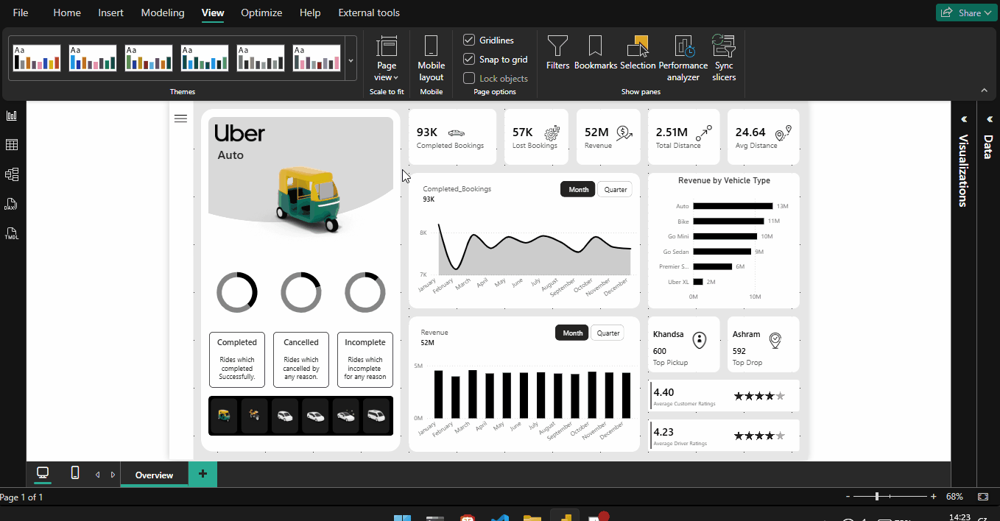
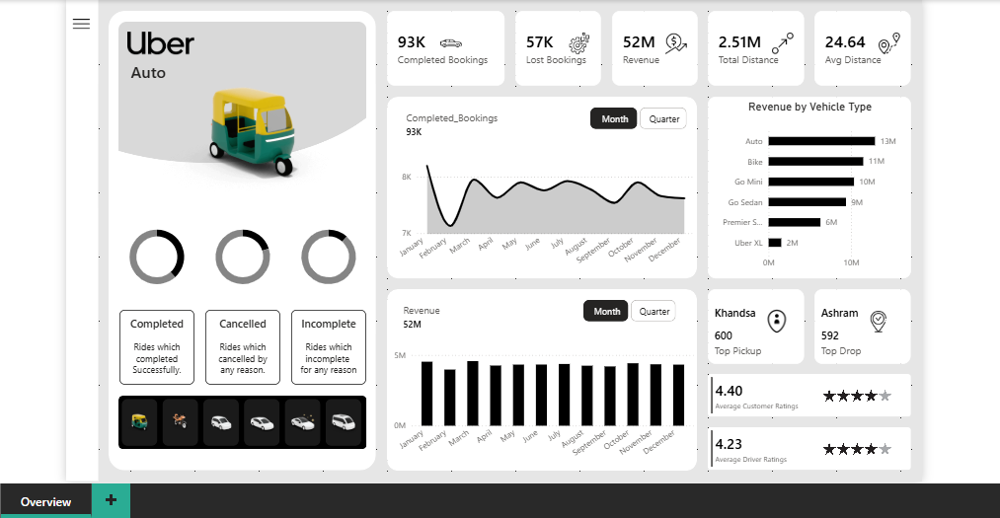

# Uber Booking Analytics Dashboard 🚖

An interactive Power BI dashboard built to analyze Uber ride bookings, revenue performance, cancellations, customer satisfaction, and vehicle-wise trends using 150,000+ booking records.

## Preview

### Dashboard Demo



### Overview



## Key Business Insights

- **Booking Performance:** 93K bookings were completed, while 57K were classified as lost, representing approximately 38% of the 150K total bookings.

- **Vehicle Revenue:** Auto generates the highest revenue at approximately 13M, followed by Bike (11M) and Go Mini (10M). Uber XL contributes the least at approximately 2M.

- **Customer Satisfaction:** Average customer rating (4.40) is slightly higher than driver rating (4.23), indicating a small satisfaction gap.

- **Location Trends:** Khandsa records the highest number of pickups (600), while Ashram leads drop-offs (592).

## Features

* KPI Monitoring
* Revenue Analysis
* Booking Trend Analysis
* Vehicle-wise Performance
* Pickup & Drop Insights
* Customer & Driver Ratings
* Bookmark Navigation
* Custom Visual Design

## Tools Used

* Power BI
* DAX
* Power Query
* Excel

## Project Structure

```
uber-booking-analytics-dashboard/
├── Uber_Dashboard.pbix
├── README.md
└── assets/
    ├── home.png
    └── overview.png
```

## Author

Portfolio project showcasing Power BI dashboard development, DAX, data modeling, and business intelligence reporting.
